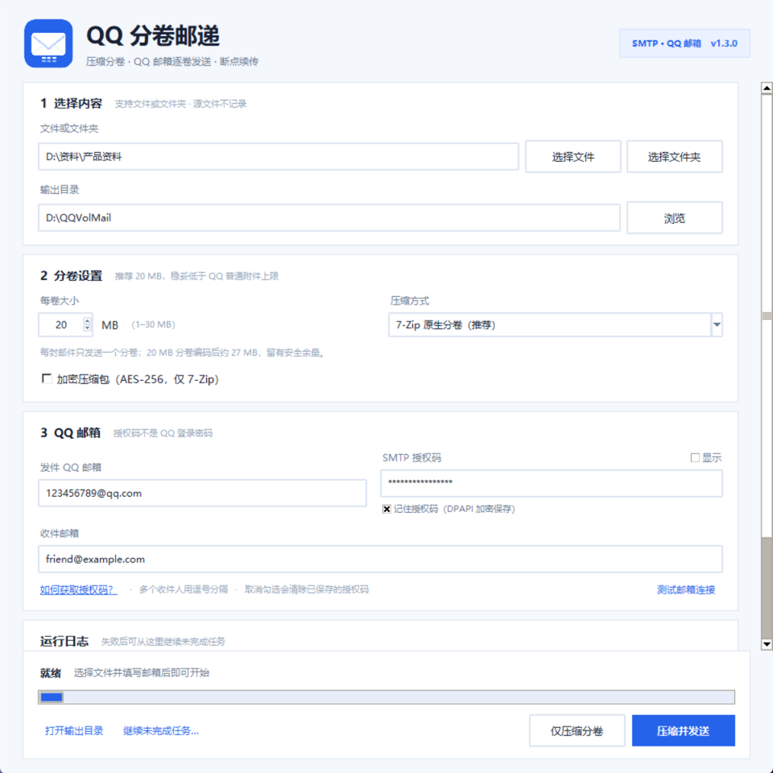

# QQ 分卷邮递

把文件或整个文件夹自动压缩成分卷，再通过 **QQ 邮箱 SMTP** 逐卷发送给指定收件人。  
后端使用 Python 标准库，界面使用 tkinter，**不需要安装任何第三方 Python 包**。



> **Windows 专属提示**：不要把 exe 放在带有 Low 完整性标签的受限目录里运行（例如 DSH 工作区）。
> 这类目录中的 exe 会继承 Low 权限，无法创建任务文件并报 `[WinError 5] 拒绝访问`。
> 请把 exe 或发布包复制到桌面、下载目录等普通位置后再运行。详见下方“v1.2.4 修复”。

## 下载

- [最新 Releases](https://github.com/wxc45/qqvolmail/releases/latest)：**Windows** 单文件版与便携版。
- [QQVolMail_v1.2.4_win64.zip](https://github.com/wxc45/qqvolmail/releases/download/v1.2.4/QQVolMail_v1.2.4_win64.zip)：单文件启动器（Windows）。
- [QQVolMail_v1.2.4_win64_portable.zip](https://github.com/wxc45/qqvolmail/releases/download/v1.2.4/QQVolMail_v1.2.4_win64_portable.zip)：便携文件夹版（Windows）。
- **macOS 目前从源码运行**（零第三方依赖），也可以自行用 `packaging/macos/build_app.sh` 打成 `.app`，
  见「macOS 快速开始」与「打包 macOS .app」。

## 功能

- **原生 7-Zip 分卷**：生成 `.7z.001`、`.7z.002`……收件人装好 7-Zip 后右键第 1 卷即可解压。
- **ZIP 兼容模式**：选择该模式时生成 `.zip.001` 等分卷，并在邮件里给出合并命令。
- **逐卷发送**：每封邮件只带一个分卷，默认 20 MB，避免超过 QQ 邮箱普通附件上限。
- **断点续传**：每个任务生成 `manifest.json`，记录已发送分卷；网络中断后只补发剩余分卷。
- **发送前校验**：自动计算每个分卷的 SHA-256，收件人可核对完整性。
- **安全**：源文件不写入设置；授权码可选保存，首次保存会弹窗提示，
  Windows 用 DPAPI 加密、macOS 用系统钥匙串保存（设置文件不含授权码）。
- **图形界面**：文件/文件夹选择、邮箱连接测试、进度条、取消、失败续传。
- **设置记忆**：记住输出目录、分卷大小、压缩方式、发件人、收件人、上次任务、窗口位置，
  以及（可选）SMTP 授权码。
- **跨平台**：同一份代码支持 Windows / macOS / Linux；没有 7-Zip 时 `auto` 自动降级为
  纯标准库 ZIP 分卷，macOS 开箱即用。
- **命令行**：方便配合 Windows 任务计划程序或 macOS `launchd` / cron 做定时发送。

## v1.2.4 修复

- **重要：exe 必须放在普通可写目录（桌面、下载目录等）运行，不能直接放在带 Low 完整性标签的受限目录。**
  这类目录（例如 DSH 工作区）带有
  `Mandatory Label\Low Mandatory Level:(NW)`；从这个目录启动的 exe 会继承 Low 完整性级别，
  无法在 `C:\Users\...\QQVolMail`、`D:\...` 等普通目录创建任务文件，报
  `[WinError 5] 拒绝访问`。把 exe 复制到桌面或下载目录后，Windows 会以正常权限启动，
  写入恢复正常。
- v1.2.4 同时让单文件启动器和便携版主程序请求管理员权限（UAC），用于普通机器上的受保护目录；
  如果系统已禁用 UAC，该清单会被忽略，因此“复制到普通目录”仍是必须步骤。
- 如果 UAC 选择“否”，程序不会启动，这是预期行为；不会出现“界面打开但无法创建任何文件”的半失败状态。
- 仍保留批处理启动方式，作为不能/不想使用单文件启动器时的备用方案。

## v1.2.3 修复

- 修复压缩或发送失败时，错误处理代码误用不存在的 `_progress` 属性，导致真正的错误被“界面事件处理失败”覆盖、任务状态无法复位的问题。
- 错误处理恢复为 `self.progress`，并补充了回归测试；失败时会正常弹出原始错误并保留任务目录，便于续传。

## v1.2.2 修复

- 大文件压缩阶段每 10 秒输出一次 7-Zip 心跳（已运行秒数），不再像“卡住”。
- 增加“正在创建任务目录”“正在检查输出磁盘空间”等阶段检查点。
- 后台界面事件处理增加异常隔离，单个事件失败不会再中断日志轮询。
- 扫描文件夹时跳过符号链接、目录联接（junction）和云占位符，避免递归成环。
- 处理 600 MB / 6 个文件的文件夹时，确认能进入 7-Zip 压缩并在日志中持续报告进度。

## 环境要求

| 平台 | 要求 |
| --- | --- |
| Windows 10/11 | 直接用 exe 不需要 Python；从源码运行需 Python 3.10+ |
| macOS | Python 3.10+（需自带 tkinter；实测 macOS 27 / Python 3.13 / Tk 9.0 可用） |
| Linux | Python 3.10+ 与 tkinter；建议安装 `xdg-open` |

- 后端与界面只使用 **Python 标准库**，运行时零第三方依赖。
- **7-Zip 完全可选**：Windows 默认查找 `C:\Program Files\7-Zip\7z.exe`，
  macOS/Linux 查找 `7zz` / `7z` / `7za`（含 `/opt/homebrew/bin`、`/usr/local/bin`），
  也可以用 `SEVENZIP_PATH` 指定。
- 找不到可用的 7-Zip 时，`auto` 模式会**自动降级为 ZIP 分卷**，无需额外安装；
  显式选择「7-Zip 原生分卷」才会报错。
- macOS 使用系统自带的 `/usr/bin/security` 保存授权码到钥匙串。

> 首次使用前，需要在 QQ 邮箱中开启 SMTP 服务并生成授权码，见下一节。

## 快速开始（Windows 图形界面）

**方式一：使用 exe（推荐给普通用户）**

1. 把 `QQVolMail_v1.2.4_win64.zip` 解压到**桌面或下载目录**（不要解压到带 Low 完整性标签的受限目录），
   双击其中的 **`QQ分卷邮递.exe`**。
2. 第一次启动会在 exe 旁边创建 `QQVolMail_runtime` 文件夹，把内置程序解压进去，
   然后启动主界面；之后启动会直接复用，不再重复解压。
3. 启动时会依次出现 SmartScreen 和 UAC：SmartScreen 点“更多信息”→“仍要运行”，
   UAC 点“是”。程序需要管理员权限才能在任意输出目录创建分卷。
4. 如果 exe 所在文件夹没有写入权限（例如放在 `Program Files`），
   改用 `QQVolMail_v1.2.4_win64_portable.zip`，解压到可写目录后运行。
5. 点击「选择文件」或「选择文件夹」，再选择输出目录。
6. 设置每卷大小（建议 20 MB）和压缩方式。
7. 填写发件 QQ 邮箱、SMTP 授权码、收件邮箱。
8. 建议先点「测试邮箱连接」，确认授权码正确。
9. 点「仅压缩分卷」可先检查分卷结果；点「压缩并发送」开始正式发送。
10. 发送失败时，修复网络/授权码后点击「继续未完成任务…」，选择任务目录里的
    `manifest.json`，只会补发未完成的分卷。

**方式二：从源码运行**

1. 双击 **`启动 QQ 分卷邮递.bat`**，或在此目录执行：
   ```bat
   python qqvolmail_gui.py
   ```
2. 后续步骤同上。

> exe 未做商业代码签名，Windows SmartScreen 可能提示“Windows 已保护你的电脑”。
> 如确认文件来源可信，点击“更多信息”→“仍要运行”；随后在 UAC 提示中点“是”。
> 程序必须放在普通可写目录，并从那里启动；DSH 工作区是 Low 完整性目录，
> 放在其中的 exe 会被系统降权，无法创建任务文件。

### 如何获取 QQ 邮箱授权码

授权码不是 QQ 登录密码，而是 QQ 邮箱给第三方客户端生成的专用密码。

1. 浏览器登录 [QQ 邮箱](https://mail.qq.com/)。
2. 点击右上角「设置」→「账号」。
3. 找到「POP3/IMAP/SMTP/Exchange/CardDAV/CalDAV 服务」。
4. 开启「POP3/SMTP 服务」或「IMAP/SMTP 服务」。
5. 按页面提示完成短信/密保验证，生成 **16 位授权码**。
6. 把授权码填入本工具。修改 QQ 密码后授权码会失效，需要重新生成。

界面里的「如何获取授权码？」按钮也包含同样的步骤。

## macOS 快速开始

1. 确认 Python 自带 tkinter（系统自带的 Python 可能缺少，推荐 python.org 或 Homebrew 版本）：
   ```bash
   python3 -c "import tkinter; print('Tk', tkinter.TkVersion)"
   ```
2. 在仓库目录双击 **`run.command`**，或在终端执行：
   ```bash
   ./run.command
   # 等价于
   python3 launch_gui.pyw
   ```
   如果双击被系统拦截，先在终端执行一次 `chmod +x run.command`，
   再到「系统设置 → 隐私与安全性」允许运行。
3. 只压缩分卷（不发送，零依赖、无需 7-Zip）：
   ```bash
   python3 qqvolmail.py prepare \
     --source ~/Documents/产品资料 \
     --output ~/QQVolMail \
     --volume-mb 20 --format auto
   ```
4. 「压缩方式」保持 `auto` 即可：没有 7-Zip 会自动降级为 ZIP 分卷；
   装了官方 macOS 版 `7zz` 才会生成 `.7z.001` 原生分卷。
5. 勾选「记住授权码」后，授权码存入 **macOS 钥匙串**（条目 `QQVolMail SMTP`），
   `settings.json` 里只有 `keychain:<发件邮箱>` 引用，不含授权码；
   首次保存会弹窗确认，系统可能要求一次钥匙串访问授权。
6. 设置文件在 `~/Library/Application Support/QQVolMail/settings.json`，
   旧版 `~/QQVolMail/settings.json` 会自动读取兼容。
7. 收件人在 macOS / Linux 合并分卷：
   ```bash
   cat 产品资料.zip.* > 产品资料.zip
   ```
   邮件正文会自动同时给出 Windows 与 macOS/Linux 两套合并命令。

> macOS 不需要管理员权限、UAC、SmartScreen，也不使用 `launcher/` 里的 C# 启动器。
> `*.bat` 是 Windows 专用，`run.command` 是 macOS 专用。

## 设置持久化

图形界面会自动保存以下设置，下次打开时恢复：

- 输出目录
- 每卷大小、压缩方式
- 发件 QQ 邮箱、收件邮箱
- 上次任务目录（供「继续未完成任务…」使用）
- 窗口大小与位置
- **SMTP 授权码（可选）**

### 授权码保存说明

| 平台 | 保存方式 | settings.json 内容 |
| --- | --- | --- |
| Windows | DPAPI 加密，与当前 Windows 登录用户绑定 | `dpapi:` + 密文 |
| macOS | 系统钥匙串条目 `QQVolMail SMTP`（用 `/usr/bin/security` 读写） | **只有** `keychain:<发件邮箱>` 引用 |
| 其他系统 | 不支持安全保存，请每次手动填写 | 不写入授权码 |

- 默认勾选「记住授权码」，但**第一次保存前会弹窗提示**；只有确认后才会写入。
- macOS 用 `-X` 十六进制参数传给 `security`，授权码不会以明文出现在命令行；
  取消勾选「记住授权码」会删除对应的钥匙串条目。
- 早期版本在非 Windows 上使用的是 Base64（**明文等价**）。新版不再写入这种格式，
  但读取旧设置时仍兼容；如果曾经勾选过，建议取消勾选后重新保存一次。
- 任何平台都无法防御已登录本机账户的人或恶意程序；**不建议在共用电脑上保存**。
- 如果 Windows 的加密设置被复制到另一个用户，授权码将无法解密，软件会自动清除它。

以下内容**不会**保存：

- 源文件/文件夹：每次启动都是空的，避免误发上一次的文件

设置文件位置取决于运行方式：

| 运行方式 | settings.json 位置 |
| --- | --- |
| 单文件 exe（启动器，Windows） | `<exe目录>\QQVolMail_runtime\data\settings.json` |
| 便携文件夹版（Windows） | `<便携目录>\data\settings.json` |
| 从源码运行（Windows） | `%APPDATA%\QQVolMail\settings.json` |
| 从源码运行（macOS） | `~/Library/Application Support/QQVolMail/settings.json` |
| 从源码运行（Linux） | `$XDG_CONFIG_HOME/QQVolMail/settings.json` 或 `~/.config/QQVolMail/settings.json` |
| `.app` 打包版（macOS） | 与源码版相同：`~/Library/Application Support/QQVolMail/settings.json` |

exe 模式是绿色便携方式，设置跟随程序文件夹，不依赖 `%APPDATA%`。
如果 exe 目录里还没有设置文件，会尝试读取旧的 `%APPDATA%\QQVolMail\settings.json`
并迁移过来。macOS 源码版也会自动兼容旧版写在 `~/QQVolMail/settings.json` 的设置。

默认输出目录也随模式变化：exe 使用程序目录下的 `output`，源码运行使用
`~/QQVolMail`（Windows 为 `C:\Users\<用户名>\QQVolMail`）。可以在界面中随时修改。

如需清空所有记住的设置，退出软件后删除对应的 `settings.json` 即可。
旧版本遗留的 `source` 字段会在启动时自动忽略，并在下次保存时移除。

## 命令行用法

所有命令都在本目录执行。建议把授权码放在环境变量里，避免出现在命令历史中：

```bat
:: Windows（CMD）
set QQ_SMTP_AUTH_CODE=你的16位授权码
```

```bash
# macOS / Linux
export QQ_SMTP_AUTH_CODE=你的16位授权码
```

> 下面的示例是 Windows 写法（`python`、`^` 续行、`D:\` 路径）。
> macOS / Linux 请换成 `python3`、`\` 续行和 `~/` 路径，**参数名完全一致**；
> `qqvolmail.bat` 与 `copy config.example.json config.json` 那一步在 macOS 用
> `cp config.example.json config.json`。

### 1. 只压缩分卷（不发送）

```bat
python qqvolmail.py prepare --source "D:\资料\产品资料" --output "D:\QQVolMail" --volume-mb 20
```

### 2. 压缩并发送

```bat
python qqvolmail.py send ^
  --source "D:\资料\产品资料" ^
  --output "D:\QQVolMail" ^
  --volume-mb 20 ^
  --sender "123456789@qq.com" ^
  --to "friend@example.com"
```

多个收件人：

```bat
--to "a@example.com,b@example.com"
```

### 3. 继续未完成任务

```bat
python qqvolmail.py resume "D:\QQVolMail\产品资料_20261103_215615"
```

任务目录里包含 `manifest.json`，也可以直接指定它。已发送的分卷会跳过。

### 4. 测试 SMTP 登录

```bat
python qqvolmail.py test --sender "123456789@qq.com"
```

### 5. 使用配置文件

复制 `config.example.json` 为 `config.json`，按需修改（不要写授权码）：

```bat
copy config.example.json config.json
python qqvolmail.py send --config config.json
```

配置优先级：**命令行参数 > 配置文件 > 默认值**。

配置字段说明：

| 字段 | 说明 |
| --- | --- |
| `source` | 要压缩的文件或文件夹 |
| `output` | 输出根目录 |
| `volume_mb` | 每卷大小，1–30，默认 20 |
| `format` | `auto` / `7z` / `zip` |
| `level` | 压缩级别 0–9，默认 5 |
| `sender` | 发件 QQ 邮箱 |
| `recipients` | 收件邮箱数组 |
| `subject_prefix` | 邮件主题前缀 |
| `smtp_host` / `smtp_port` | 默认 `smtp.qq.com` / `465` |
| `send_interval` | 每封邮件间隔秒数，默认 3 |
| `max_retries` | 网络失败重试次数 |
| `auth_code_env` | 保存授权码的环境变量名 |

## 收件人如何解压

### 7-Zip 分卷（推荐）

1. 把全部 `.7z.001`、`.7z.002`……下载到**同一个文件夹**。
2. 安装 [7-Zip](https://www.7-zip.org/)。
3. 右键点击第 1 卷（`.001`）→「7-Zip」→「提取到当前文件夹」。

如果压缩结果只有一卷，会保存为普通 `.7z`，直接解压即可。

### ZIP 分卷

邮件正文会**同时给出 Windows 与 macOS / Linux 两套命令**，收件人按自己的系统任选一种：

```bat
:: Windows（命令提示符 CMD）
copy /b "sample.zip.001" + "sample.zip.002" + "sample.zip.003" "sample.zip"
```

```bash
# macOS / Linux（先 cd 到分卷所在目录）
cat sample.zip.* > sample.zip
```

合并后解压 `sample.zip`。分卷很多时，Windows 部分会改用 PowerShell 合并命令，
macOS / Linux 的 `cat` 命令不变。请勿重命名或缺少任何分卷。

## 输出目录结构

```text
D:\QQVolMail\
└─ 产品资料_20261103_215615\
   ├─ manifest.json        # 任务清单、分卷哈希、发送进度
   ├─ 解压说明.txt          # 给收件人的说明（可一起发送）
   ├─ 产品资料.7z.001
   ├─ 产品资料.7z.002
   ├─ 产品资料.7z.003
   └─ 7z.log               # 7-Zip 压缩日志
```

任务目录可以直接整个复制/备份；`manifest.json` 中记录了每个分卷的大小与 SHA-256。
任务目录中的 `manifest.json`、`7z.log` 等文件不会包含授权码；授权码只会加密保存在
对应模式的 `settings.json` 中。

## 重要限制与注意事项

- **QQ 普通附件上限约 50 MB**。本工具默认 20 MB 分卷，30 MB 是上限；超过 30 MB
  会直接拒绝，避免发送到一半被退信。
- 分卷越多，邮件封数越多。QQ 邮箱对每日发信量有限制，大量文件建议使用网盘/超大附件。
- 所有分卷必须齐全且放在同一目录才能解压，请提醒收件人不要重命名。
- 输出目录不能位于待压缩文件夹内部，否则会把输出文件自己压进去；界面会拦截。
- `7z.log` 可能包含本机路径，分享任务目录前可自行删除。
- 本工具使用 QQ 邮箱普通 SMTP 附件，不支持「超大附件」链接。

## 断点续传原理

`manifest.json` 中的 `send.sent_parts` 记录已成功发送的卷号：

```json
"send": {
  "status": "partial",
  "sent_parts": [1, 2],
  "last_error": "网络或服务器暂时不可用..."
}
```

- 再次执行 `resume` 或点击「继续未完成任务…」时，只会发送 `sent_parts` 之外的分卷。
- 全部发送成功后状态变为 `sent`，再次执行不会重复发送。
- 只有明确需要重发全部邮件时，才使用：
  ```bat
  python qqvolmail.py resume "任务目录" --force
  ```

## 常见问题

### `535 Authentication failed`

- 发件邮箱要填完整，例如 `123456789@qq.com`。
- 必须使用 QQ 邮箱的 **SMTP 授权码**，不是 QQ 登录密码。
- 确认 QQ 邮箱设置中已开启 SMTP 服务。
- 修改过 QQ 密码后，需要重新生成授权码。

### `550` / `552` / 邮件被拒收

通常是附件过大或被邮箱安全策略拦截。把 `--volume-mb` 调到 15–20 后重新创建任务。

### 连接超时

QQ 邮箱 SSL 端口是 `465`。检查网络、代理、防火墙；公司网络可能封禁 SMTP。

### 提示找不到 7-Zip

Windows 安装 [7-Zip](https://www.7-zip.org/)，或设置环境变量：

```bat
set SEVENZIP_PATH=C:\Program Files\7-Zip\7z.exe
```

macOS 从 [7-Zip 官方下载页](https://www.7-zip.org/download.html) 取命令行版
（Apple Silicon 用 `7z2606-mac.tar.xz`，Intel 用 `7z2606-mac-x64.tar.xz`）：

```bash
curl -LO https://github.com/ip7z/7zip/releases/download/26.06/7z2606-mac.tar.xz
python3 -c "import tarfile; open('7zz','wb').write(tarfile.open('7z2606-mac.tar.xz').extractfile('7zz').read())"
mkdir -p ~/.local/bin && mv 7zz ~/.local/bin/7zz && chmod +x ~/.local/bin/7zz
```

然后把 `~/.local/bin` 加入 PATH，或直接指定路径：

```bash
export SEVENZIP_PATH="$HOME/.local/bin/7zz"
```

不安装也没关系：`auto` 模式会自动降级为 ZIP 分卷；只有命令行显式指定
`--format 7z`（或配置里写死 `7z`）而本机又没有可用二进制时才会报错。
程序会扫描 PATH 中的**所有**同名候选、执行 `<bin> i` 并要求输出含 `7-Zip` 标识，
避免 PATH 前段的坏命令或转发壳脚本遮蔽后面真正可用的 7-Zip。

> 已在 macOS arm64 + 7-Zip 26.06 实测：`.7z.001` 原生多卷生成、`7zz t` 校验通过、
> 中文路径完好、`-bsp1` 进度参数可用，且 POSIX 下不带 Windows 专属的 `-sccUTF-8`。

### 大文件压缩时看起来像“卡住”

v1.2.2 起，界面会按阶段输出检查点日志：

- `正在创建任务目录...`
- `正在检查输出磁盘空间...`
- `7-Zip 已启动，正在压缩并写入分卷...`
- `7-Zip 正在压缩...已运行 N 秒`（每 10 秒一次心跳）

压缩 500 MB 以上的文件（尤其是已经压缩过的 zip/exe）可能需要几分钟。只要
“已运行 N 秒”仍在增长，就说明 7-Zip 正在工作，不是卡死。

如果停在“正在创建任务目录”或“正在检查输出磁盘空间”超过 1 分钟：

- 输出目录不要选网络盘、移动硬盘或同步盘；
- 确认当前用户对输出目录有写权限；
- 查看任务目录里的 `7z.log` 是否有错误信息。

v1.2.2 同时修复了两个会导致界面停止刷新的问题：后台事件处理异常会中断日志轮询，
以及扫描文件夹时可能跟随目录联接（junction）递归。

### 控制台中文乱码

Windows 在命令行先执行：

```bat
chcp 65001
```

macOS / Linux 终端默认 UTF-8，无需额外设置；图形界面不受影响。

## 开发与测试

```bash
python3 -m unittest discover -s tests -p "test_*.py" -v
```

Windows 把 `python3` 换成 `python`。测试使用假的 SMTP 类，不会联网、不会发送真实邮件；
macOS 钥匙串集成测试会创建一次性临时钥匙串并在结束时删除，**不会触碰登录钥匙串**
（其余 GUI 测试使用内存替身）。覆盖：

- 7-Zip 原生分卷、单卷重命名（未安装 7-Zip 时自动跳过）
- ZIP 分卷、合并、哈希；邮件正文的 Windows / macOS 双平台合并命令
- 文件夹压缩、中文路径、空目录
- 邮件 MIME、附件名、正文
- 发送成功、断点续传、认证失败、元数据不一致
- 设置持久化、源文件不落盘、窗口位置恢复
- 授权码：DPAPI 分支回归、钥匙串引用与真实临时钥匙串读写删、无安全存储时拒绝明文回退
- 平台适配：Windows `.\` 与 `-sccUTF-8` / POSIX 参数、macOS 设置目录与 `open`、字体与图标

## 目录结构

```text
qqvolmail/
├─ qqvolmail.py          # 核心后端 + CLI
├─ qqvolmail_gui.py      # tkinter 图形界面
├─ launch_gui.pyw        # 无控制台启动入口（各平台通用）
├─ run.command           # macOS 双击启动入口
├─ launcher/             # Windows 单文件启动器（C# 源码 + 打包脚本）
├─ packaging/macos/      # macOS .app 打包脚本
├─ 启动 QQ 分卷邮递.bat  # Windows 双击启动入口
├─ config.example.json
├─ qqvolmail.bat         # Windows 命令行包装
├─ assets/               # app.ico / app.png / exe 版本信息
├─ screenshots/          # 界面预览
└─ tests/
   ├─ test_core.py          # 分卷、邮件、SMTP、续传、平台参数、合并指引
   └─ test_gui_settings.py  # 设置持久化、授权码保险库、macOS 路径/字体/图标
```

## 已打包的 exe

- `QQ分卷邮递.exe`：单文件启动器。第一次运行时在 exe 旁边创建
  `QQVolMail_runtime`，把内置便携版解压进去并启动，之后直接复用。
  不依赖 `%TEMP%`，也不会再出现 “Could not create temporary directory”。
  v1.2.4 起启动器与主程序均请求管理员权限（UAC），以避免 SmartScreen
  以普通权限启动后无法创建任务文件。
- `QQ分卷邮递_v1.2.4_win64_portable.zip`：文件夹版。适合 exe 所在目录不可写，
  或希望完全手动管理程序文件的情况。
- 7-Zip 仍建议单独安装；不安装时可在界面选择 ZIP 兼容模式。

## 重新打包 exe

**第一步：生成便携文件夹版**

```bat
python -m PyInstaller --noconfirm --clean --onedir --windowed --uac-admin ^
  --name "QQ分卷邮递" ^
  --icon "assets\app.ico" ^
  --add-data "assets;assets" ^
  --version-file "assets\version_info.txt" ^
  --distpath "dist_portable" --workpath "build_portable" ^
  launch_gui.pyw
```

**第二步：把便携版嵌入单文件启动器**

```powershell
powershell -ExecutionPolicy Bypass -File "launcher\build_launcher.ps1"
```

脚本会压缩 `dist_portable\QQ分卷邮递`，调用 Windows 自带的 .NET Framework
C# 编译器生成 `dist\QQ分卷邮递.exe`。这样单文件启动器不需要 PyInstaller
的临时解压机制，也不需要安装 Python；使用 Windows 10/11 自带的
.NET Framework 4.x 运行。启动器通过 `launcher\launcher.manifest`
请求 `requireAdministrator`，主程序通过 PyInstaller `--uac-admin` 内嵌
同样的清单；两者缺一不可。

## 打包 macOS .app（可选）

运行时依旧零第三方依赖；只有**构建这一步**需要 PyInstaller。
推荐装在项目内的 `.venv`（已被 `.gitignore` 忽略，不污染全局 Python）：

```bash
python3 -m venv .venv
.venv/bin/python -m pip install pyinstaller
PATH="$PWD/.venv/bin:$PATH" ./packaging/macos/build_app.sh
```

脚本会：

1. 用 `sips` + `iconutil` 从 `assets/app.png` 生成 `assets/app.icns`；
2. 用 `--windowed --onedir` 生成 `dist_mac/QQ分卷邮递.app`，并把 `assets/` 一起打进包；
3. 打印产物路径与首次运行注意事项。

产物内置 Python 运行时，但**没有 Apple 签名与公证**：首次打开可能需要在
「系统设置 → 隐私与安全性」点击「仍要打开」，或执行：

```bash
xattr -dr com.apple.quarantine "dist_mac/QQ分卷邮递.app"
```

`.app` 版与 macOS 源码版共用 `~/Library/Application Support/QQVolMail/settings.json`，
不会把设置写进 app 包内部。Windows 的 exe 打包流程见上一节，两者互不影响。

已实测（macOS arm64 / Python 3.13 / PyInstaller 6.22.3）：产物约 28 MB，
`Contents/Resources` 内含 `app.icns` 与 `assets/app.png`，
执行内含可执行文件加 `--selftest` 返回 0 并成功写出 `settings.json`。
脚本里 `--add-data` 使用**绝对路径**：PyInstaller 会把相对源路径按 `--specpath`
目录解析，写成 `assets:assets` 会报找不到资源。

测试集：`SEVENZIP_PATH` 指向 7zz 时 47 项单测全部执行；未安装 7-Zip 时
2 个原生分卷用例自动跳过，其余 45 项照常运行。

